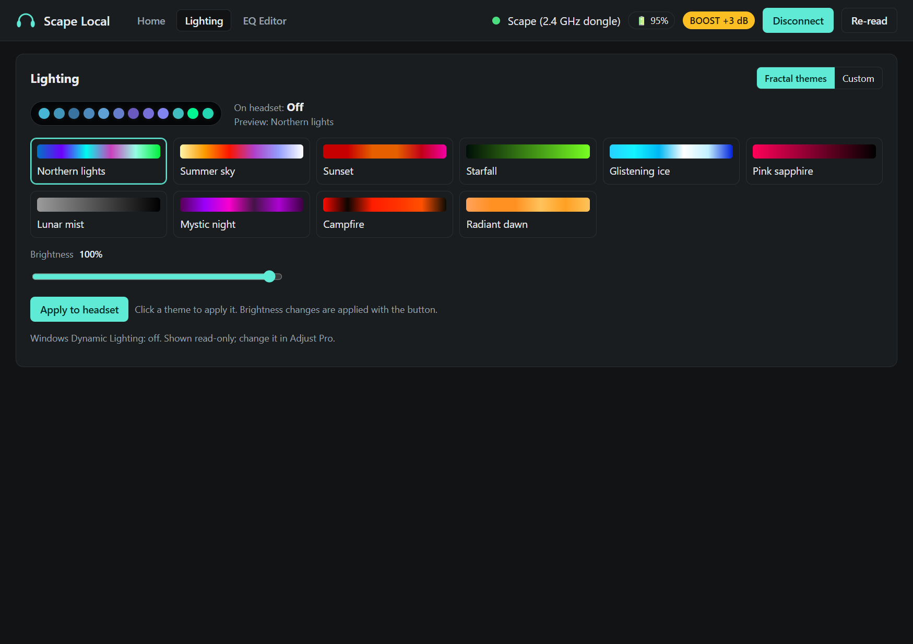
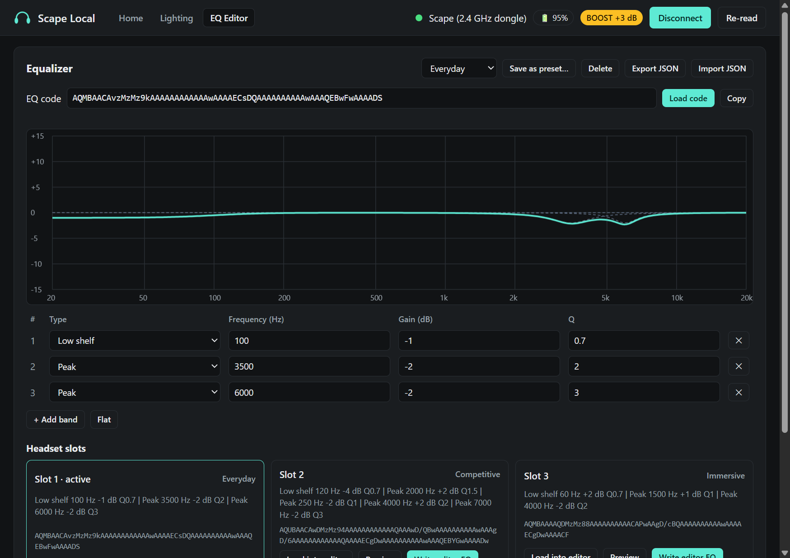

# Scape Local

**An offline, open-source configurator for the Fractal Design Scape headset.** It does what
Fractal's *Adjust Pro* web app does for daily use (EQ slots, lighting, sidetone, mic noise
cancellation) and adds a system-wide **Boost** for when max volume isn't loud enough. It runs
from the Windows system tray, starts with Windows, and never touches the internet.

> Not affiliated with or endorsed by Fractal Design. "Fractal Design", "Scape" and "Adjust Pro"
> are trademarks of Fractal Design. Use at your own risk; see [Safety](#safety).


## Why

Adjust Pro is a website (adjust.fractal-design.com) that talks to the headset over WebHID. If
that site changes or goes away, the headset's EQ and settings become hard to manage. Scape Local
re-implements the parts you need locally, after mapping the headset's HID protocol (see
[PROTOCOL.md](PROTOCOL.md)).

## Features

- **EQ slots:** see the headset's three EQ slots by name and switch between them with one click.
- **EQ Editor:** up to 5 bands (peak, low/high shelf, low/high pass, notch, band pass), live
  frequency-response graph, Adjust Pro-compatible **EQ share codes** (paste/copy), presets with
  JSON import/export. It writes to the headset with automatic backup and read-back verification.
- **Lighting** (its own tab): all 10 Fractal themes (Northern lights, Sunset, Starfall, …) and custom patterns
  (Shift, Still, Breathe, Waves, Two color fade, Lava lamp) with your own colours, speed and
  brightness, plus a live preview of the 12 LEDs. Effects are rendered byte-identical to Adjust Pro.
- Lighting on/off, a **sidetone** slider (0 to 100 %), **mic noise cancellation** on/off. Optional
  "my defaults" that are re-applied every time the headset connects.
- **Boost:** a slider from +1 to +14 dB (112 to 501 %), like a browser "amplify" extension but
  system-wide:
  - **PC mode** (Windows): a preamp scoped to the Scape's playback device through
    [Equalizer APO](https://sourceforge.net/projects/equalizerapo/). Works with every preset.
  - **Headset mode:** adds a +X dB high-shelf band to the active slot, so it also works on a
    console or another PC (up to +12 dB; needs a preset with 4 bands or fewer).
- **Mic Boost:** +1 to +12 dB for your microphone (Windows, through Equalizer APO on the Scape's
  mic only), so people hear you louder in Discord, games and calls. Lives in the Boost card.
- **Tray app:** starts hidden with Windows, battery level in the tray tooltip, works over the
  2.4 GHz dongle or USB-C.
- **Offline and private:** no account, no telemetry. The app blocks all network requests.





## Install

Download `Scape-Local-Setup-<version>.exe` from [Releases](../../releases) and run it.

- The installer is **not code-signed**, so Windows SmartScreen will warn. Click
  **More info → Run anyway**. You can check the download against `SHA256SUMS.txt` in the release.
- It installs per-user (no admin). For PC Boost it offers to install the bundled
  **Equalizer APO 1.4.2** (GPL; its source is attached to the release). In APO's Configurator,
  tick only the Scape's playback device ("Headset Earphone (Fractal Scape Dongle)") and, for Mic
  Boost, its microphone on the *Capture devices* tab, then restart.

Full details, updating, uninstalling and rebuilding: [INSTALL.md](INSTALL.md).

## Safety

The app talks to the headset through a strict **allowlist** of HID commands
([`protocol.js`](app/renderer/js/protocol.js)):

- **Firmware update, bootloader/reboot and factory reset can't be sent.**
- Every packet's arguments are range-checked. EQ values are validated (20 Hz to 20 kHz, ±12 dB, Q 0.4 to 10).
- Before an EQ slot is overwritten, its contents are backed up. After writing, the slot is read
  back and compared. Overwriting a slot from the editor asks for confirmation.
- Lighting uploads only go to effect slot 1 (the one Adjust Pro uses). Clearing a slot, boot
  effects and the Windows Dynamic Lighting switch are blocked. The stored effect is read back after each upload.
- Every packet sent and received is shown in the **HID packet log** (EQ Editor tab).

Tested on a Scape over the 2.4 GHz dongle (dongle FW 03.21.00, headset FW 03.30.00). USB-C
direct mode uses the same commands but hasn't been tested yet.

**Hearing:** Boost can make audio a lot louder. Turn the volume down before enabling it. Very
loud content may clip (crackle) at high Boost levels.

## Roadmap / not yet supported

- **Windows Dynamic Lighting (WDL)** is shown read-only. Switching it makes the headset reconnect
  (it sends no reply), so the switch is blocked for now; use Adjust Pro for that setting.
- USB-C direct mode is untested (should work; same commands).
- Mic EQ (documented in PROTOCOL.md §7, no UI yet).
- Whether settings survive a headset power cycle hasn't been confirmed. "Re-apply on every connect"
  covers the defaults either way.

## How it works

| Path | What |
|---|---|
| [`PROTOCOL.md`](PROTOCOL.md) | The headset's HID protocol: report layout, every command, EQ write sequence, what is blocked and why |
| [`app/renderer/js/`](app/renderer/js) | Plain ES modules: `protocol.js` (packets and allowlist), `hid.js` (WebHID), `eqcode.js` (share codes), `biquad.js` (RBJ filters), `lighting.js` (effect rendering and upload), `boost.js`, `app.js` / `lighting-ui.js` (UI) |
| [`app/main.cjs`](app/main.cjs), [`apo-host.cjs`](app/apo-host.cjs) | Electron shell: tray, autostart, HID permissions, network block, Equalizer APO config |
| [`app/tests/`](app/tests) | 71 Node tests: share codes (byte-exact), filter math, lighting effects (golden vectors), allowlist, Boost and Mic Boost round trips, APO config restore |

The UI also runs in Chrome or Edge without Electron (`node tools/serve.js app/renderer 8741`,
then open http://localhost:8741) for the EQ tools and WebHID access. There's no tray or PC Boost there.

## Build

```powershell
cd app
npm install
npm test
npm start          # run from source
npm run dist       # installer + release kit (needs the APO files in vendor/, see INSTALL.md)
```

Electron 44.10.2, electron-builder 26.18.0.

## License

[MIT](LICENSE) for this project. The bundled Equalizer APO installer is GPL-2.0 (© Jonas
Thedering); its unmodified source archive is published alongside each release.
